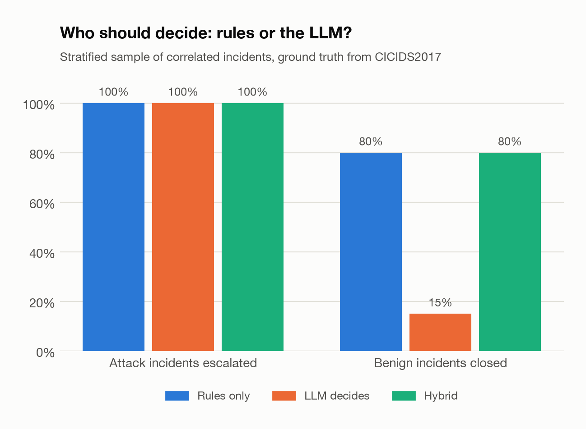
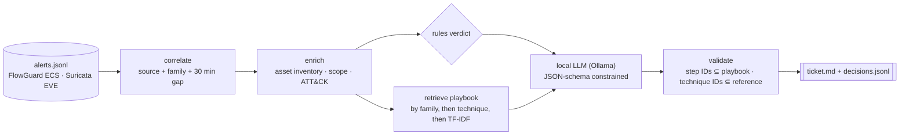

# AlertLens: LLM-assisted SOC alert triage

[](https://github.com/hugo-kte/alertlens/actions/workflows/ci.yml)

-black)


AlertLens turns a stream of intrusion-detection alerts into a short list of incidents an analyst
can act on. It **correlates** alerts into incidents, **enriches** them with the asset inventory,
**retrieves** the matching incident-response playbook and asks a **local LLM** (Ollama, nothing
leaves the machine) for a ticket-ready summary and the playbook steps to run.

It is also an experiment with a clear question: **should the LLM decide, or only explain?** Every
claim below is measured against ground truth: 6,985 alerts raised by
[FlowGuard](https://github.com/hugo-kte/flowguard-nids) on replayed CICIDS2017 traffic, where the
real label of every alert is known.

## Results

| | |
|---|---|
| Correlation | **6,985 alerts → 240 incidents** (29× fewer items to review); 20 are real attacks, 220 are false positives |
| Rules on all 240 incidents | **100%** of attack incidents escalated, **83%** of benign incidents closed automatically |

On a stratified sample (all 20 attack incidents + 40 random benign ones), with `llama3.2:3b` on a
laptop CPU:

| Who decides | Attacks escalated | Benign incidents closed | Summaries with unsupported claims | Mean latency |
|---|---:|---:|---:|---:|
| Rules only | 100% | **80%** | – | < 1 ms |
| LLM decides | 100% | 15% | 10 / 60 | 37 s |
| **Hybrid: rules decide, LLM explains** | **100%** | **80%** | **0 / 60** | 19 s |



**What this shows**

1. **The LLM is a poor decision-maker here.** It never missed an attack, but it escalated almost
   everything: of the 48 incidents where it returned a valid decision, it closed **1 benign
   incident out of 33** and labelled 27 of them true positives. That is alert fatigue made worse,
   at 37 seconds per incident. The other 12 decisions failed validation twice and fell back to
   the rules.
2. **Deciding also made it invent things.** When it judged, 10 of 60 summaries asserted attack
   techniques (scanning, discovery) that nothing in the incident supported. Restricted to
   explaining a verdict it did not make, it produced **zero** unsupported claims.
3. **Grounding by construction works.** The model picks playbook steps *by ID* and a validator
   drops any ID outside the retrieved playbook. No invented step reached a ticket. The 32
   "hallucinated step IDs" the report counts for the hybrid run all come from 4 incidents where
   the model copied playbook lines with their text ("`SCN-T1: Determine whether...`") instead of
   the bare ID: the parser now accepts that form.

The resulting design: **deterministic rules (or a calibrated model) own the verdict; the LLM
writes the ticket and plans the response from a playbook it cannot leave.**

## Example tickets

A real excerpt of `alertlens triage --mode hybrid` (full file in
[`docs/example_triage.md`](docs/example_triage.md)):

> ## INC-0051 · 🔴 true positive · severity high
>
> **BruteForce** from `172.16.0.1` → `192.168.10.50` · 97 alert(s) · 2017-07-04T12:20:48 · 3456 s
>
> Repeated authentication attempts to guess valid credentials against a public web server
> (Ubuntu 16, Apache) from an internal edge firewall.
>
> **ATT&CK:** T1110 Brute Force
>
> **Playbook PB-BRUTE, Password guessing against an authentication service:**
> - [ ] `BRU-T1` Check authentication logs on the target for failed and successful logins from the source.
> - [ ] `BRU-T2` Identify the targeted accounts and whether any login succeeded during or after the burst.
> - [ ] `BRU-C1` Block the source address at the firewall for the targeted service.

The summary is accurate but shows a limit: the inventory says `172.16.0.1` is the firewall's
internal side, *where inbound internet traffic is NATed*, and the model only kept "internal edge
firewall".

## How it works



* **Correlation.** Alerts sharing a source and a detector family, with less than 30 minutes
  between them, form one incident.
* **Enrichment.** Only defender-side knowledge ([`configs/assets.yaml`](configs/assets.yaml): own
  assets, internal ranges, a short ATT&CK reference). The ground truth carried by the replayed
  alerts never reaches the model; a test asserts it.
* **Playbooks** ([`playbooks/`](playbooks)) are Markdown files whose steps carry IDs (`DOS-C1`).
  Retrieval routes on metadata first (detector family, technique), which is exact and
  explainable, and falls back to TF-IDF similarity.
* **LLM output** is constrained by a JSON schema (Ollama structured outputs) and validated with
  pydantic. An escalation must cite at least one step; an invalid answer is retried once with the
  error, then the rules take over.
* **Faithfulness** ([`faithfulness.py`](src/alertlens/faithfulness.py)) extracts every IP address,
  asset name and ATT&CK technique a summary mentions and flags those absent from the incident.
  It is a lower bound on hallucinations, not a proof of correctness.

## Quickstart

```bash
git clone https://github.com/hugo-kte/alertlens.git && cd alertlens
make install
make incidents                  # 6,985 alerts -> 240 incidents (no LLM needed)
ollama pull llama3.2:3b
make triage                     # hybrid tickets for the 15 largest incidents -> runtime/triage.md
make evaluate                   # rules vs LLM vs hybrid -> reports/ (~1 h on a laptop CPU)
```

```text
alertlens incidents ALERTS            correlate and list the largest incidents
alertlens triage ALERTS --mode rules|llm|hybrid [--limit N] [-o runtime/triage.md]
alertlens evaluate [ALERTS] [--model llama3.2:3b] [--n-benign 40]
```

Bring your own alerts: FlowGuard/ECS JSON lines and Suricata EVE `alert` events are supported
([`ingest.py`](src/alertlens/ingest.py)). Point `configs/assets.yaml` and `playbooks/` at your
environment.

## Project structure

```text
src/alertlens/
├── ingest.py        ECS (FlowGuard) and Suricata EVE parsers
├── correlate.py     session-window correlation into incidents
├── enrich.py        asset inventory, network scope, ATT&CK reference
├── playbooks.py     playbook parser and retrieval (metadata routing + TF-IDF)
├── llm.py           Ollama client (JSON-schema outputs) and a scripted test model
├── triage.py        rules baseline, LLM triage, hybrid explain, validation
├── faithfulness.py  unsupported-claim checker for summaries
├── evaluate.py      ground-truth evaluation, report data
└── report.py, plots.py, cli.py
playbooks/           6 incident-response playbooks with step IDs
configs/assets.yaml  inventory of the monitored network
examples/            6,985 FlowGuard alerts (gzipped JSONL)
reports/             metrics.json, REPORT.md, triage_results.jsonl, figures/
tests/               13 tests with a scripted model (no LLM, no network)
```

## Limitations

* **One small model.** `llama3.2:3b` runs on a laptop CPU; larger models may decide better.
  The evaluation harness is model-agnostic (`--model`), so the claim can be re-tested.
* **One environment.** Alerts come from replayed lab traffic (CICIDS2017). Benign incidents there
  are mostly anomaly-detector leads; another network will have other false-positive patterns.
* **Sampled evaluation.** The model runs on 60 of the 240 incidents for time reasons; the rules
  run on all of them.
* **The faithfulness check is mechanical.** It catches invented IPs, assets and techniques, not a
  misleading sentence built from true facts (see the NAT example above).

## Responsible use

AlertLens recommends; people decide. Containment steps (blocking, isolation, account resets) are
listed for an analyst to execute, never executed automatically.

## License

[MIT](LICENSE). The sample alerts are derived from the CICIDS2017 dataset (University of New
Brunswick) through FlowGuard's replay.

<!-- portfolio-footer -->

---

<sub>Part of a cybersecurity & AI engineering portfolio: [FlowGuard](https://github.com/hugo-kte/flowguard-nids) (network IDS) · [Detection-as-code](https://github.com/hugo-kte/detection-as-code) (Sigma rules) · [Insider-threat UEBA](https://github.com/hugo-kte/insider-threat-ueba) · **AlertLens (SOC triage)** · [PromptWall](https://github.com/hugo-kte/promptwall) (LLM firewall) · [MLSeal](https://github.com/hugo-kte/secure-mlops-pipeline) (secure MLOps) · [Gleaner](https://github.com/hugo-kte/cti-to-stix) (CTI to STIX).</sub>
